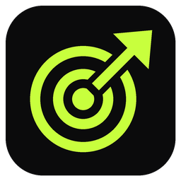
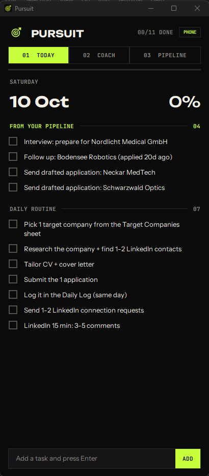
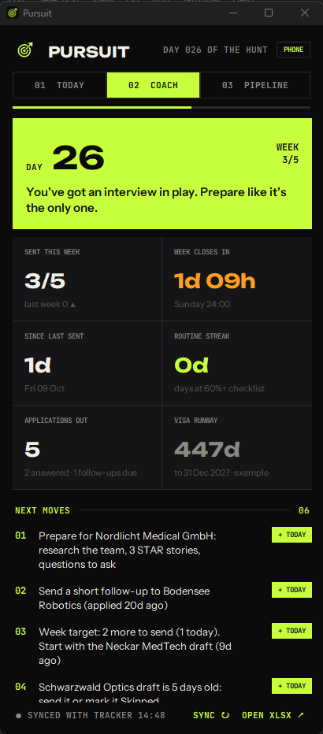
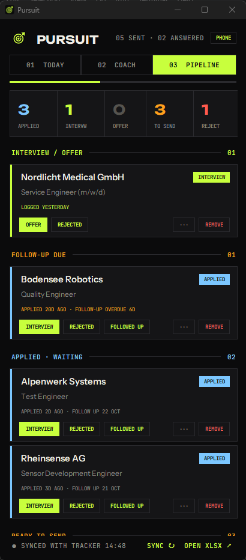

<p align="center"></p>

<h1 align="center">Pursuit</h1>
<p align="center"><b>A job-hunt app for Windows + your phone.</b><br>
Daily checklist · personal coach · live application pipeline - all driven by one Excel tracker.</p>

<p align="center">  </p>
<p align="center"><sub>Screenshots use made-up demo data.</sub></p>

---

## What it does

Pursuit sits on your PC like a normal app (own icon, taskbar, starts at login) and reads your job-search spreadsheet. Everything you click is written straight back into that spreadsheet, and the same app is available on your phone.

| Tab | What you get |
|---|---|
| **01 TODAY** | Your daily routine as a tick-list. Add tasks (type + Enter), delete them, tick them. Ticks reset every morning. On top, **"From your pipeline"** auto-tasks: follow-ups that are due, drafts waiting to be sent. |
| **02 COACH** | Day N of your job hunt · applications sent this week vs your weekly target (and vs last week) · countdown to the end of the week · days since your last application · routine streak · a motivation line that reacts to how you're doing · **Next moves**: concrete suggestions (follow up with X, send the Y draft, find a 2nd contact at Z...) with a **+ TODAY** button to put them on your checklist. |
| **03 PIPELINE** | All applications from your tracker, grouped: Interview/Offer · Follow-up due · Applied (waiting) · Ready to send (drafted) · Researching · Closed. Each card has push-buttons - **MARK APPLIED**, **INTERVIEW**, **REJECTED**, **OFFER**, **FOLLOWED UP**, **···** (any status) and **REMOVE** - which update the Excel file immediately. Click a card to open its application folder. |
| **04 INBOX** (phone) | **CAMERA** / **FILES** buttons and Android **Share → Pursuit**: photos, PDFs and links go straight into an `Inbox` folder on your PC. You pick **Job Search / Language Learning / General** before sending (or a specific application's `Attachments` folder); shared items wait in a *Sort these* list. Optional name + note. Your AI assistant reads them from there - no more Drive/WhatsApp-to-yourself. |
| **PHONE** | The same three tabs as a phone app (installable, own icon, full screen). Ticks and status changes on the phone land in the same Excel file. Works from anywhere via Tailscale (free). |

Design: black / acid-lime, custom fonts (Unbounded, JetBrains Mono, Instrument Sans) bundled - nothing to install.

---

## What you need

| Need | Why | Required? |
|---|---|---|
| **Windows 10 or 11** | Pursuit is a Windows app | Yes |
| **Microsoft Excel (desktop)** | Pursuit writes status changes into your tracker through Excel. Without Excel it can still *read* and show everything, but the buttons can't save. | Yes, for the buttons |
| **The tracker workbook** | `Job_Search_Tracker_TEMPLATE.xlsx` in this repo - setup copies it for you. Or use your own workbook with the same `Daily Log` columns (see below). | Yes |
| **Pursuit.exe** | Download from this repo's **[Releases](../../releases)** page - no Python needed. Or build it yourself with `build_exe.bat` (needs Python 3.10+). | Yes |
| **Tailscale** (PC + phone) | Lets your phone reach Pursuit on your PC from anywhere, privately. Free for personal use. | Only for the phone app |

---

## Install (5 minutes)

1. **Download this repo** - green **Code** button > **Download ZIP** - and unzip it somewhere permanent, e.g. `C:\Pursuit` (not your Downloads folder).
2. **Download `Pursuit.exe`** from the [Releases](../../releases) page and put it **in the same folder**.
3. **Right-click `setup.ps1` > Run with PowerShell.** It will
   - create `config.json` (your settings) and `Job_Search_Tracker.xlsx` (your tracker) from the templates,
   - add **Pursuit** shortcuts to the Desktop, Start menu and Startup (opens automatically at login),
   - ask whether to allow the phone app through the Windows firewall (say **y** if you want the phone app),
   - start Pursuit.
   > If Windows blocks the script: open PowerShell in the folder and run `powershell -ExecutionPolicy Bypass -File setup.ps1`.
   > If SmartScreen warns about `Pursuit.exe` ("unknown publisher"): **More info > Run anyway** - it's an unsigned self-built app.
4. **Open `Job_Search_Tracker.xlsx`**, delete the example rows, and start logging your applications in **Daily Log**.

---

## Your tracker (the Excel file)

Only the **Daily Log** sheet is required. Columns **A-M must stay in this order** (you can add more columns after M):

| Col | Header | Used for |
|---|---|---|
| A | Date | date you logged / sent it (MARK APPLIED sets it to today) |
| B | Company | card title - **must not be empty** |
| C | Role | card subtitle |
| D-F | Location, Country, Source | info only |
| G | Status | `Researching` · `Drafted` · `Applied` · `Interview` · `Offer` · `Rejected` · `No reply` · `Skipped - Not a Fit` |
| H-K | Contact, LinkedIn msg, CV version, Cover letter | info only |
| L | Follow-up Date | when to chase - drives the "Follow-up due" group |
| M | Notes | Pursuit appends dated notes here ("Followed up 2026-10-12") |

Optional sheets (Pursuit uses them if they exist, ignores them if not):

- **Target Companies** - row 1 = a note, row 2 = headers. A = Priority (P1-P3), B = Company, H = Target Status (`Not Started` ...). Feeds "next target" suggestions.
- **Connections** - LinkedIn people: A = #, B = Name, F = Target company, J = Request sent (date), K = Accepted (date), P = Status. Feeds "request pending - find a 2nd contact" suggestions.
- **Content Calendar** - B = Post date, F = Topic, J = Status (`Idea` / `Drafted` / `Posted`). Feeds "post today" / "draft Tuesday's post" suggestions.

Sheet names can be changed in `config.json` if yours are called differently.

**Application folders (optional):** if you keep one folder per application named like `Applications\2026-10\2026-10-07_CompanyName_Role\`, clicking a card opens it.

---

## Settings - `config.json`

```jsonc
{
  "tracker": "Job_Search_Tracker.xlsx",     // or a full path: "D:/Jobs/My_Tracker.xlsx"
  "applications_dir": "Applications",
  "weekly_target": 5,                       // applications per week
  "follow_up_days": 14,                     // follow-up date set when you mark something Applied
  "deadline": {"label": "Visa runway", "date": "2027-12-31", "note": "check date"},   // or null
  "sheets": {"log": "Daily Log", "targets": "Target Companies", "connections": "Connections", "content": "Content Calendar"},
  "daily_items": ["...your default routine..."]
}
```
Use forward slashes `/` in paths. Restart Pursuit after editing (right-click the header > Close, then open it again).

---

## Phone app (works anywhere)

Pursuit on your PC runs a small private web server; your phone talks to it through **Tailscale**, a free private network between your own devices.

1. **PC:** install [Tailscale](https://tailscale.com/download/windows), sign in (Google is easiest).
2. **Phone:** install Tailscale (Play Store / App Store), sign in with the **same account**, switch it on.
3. **Turn on HTTPS** (needed so the phone can install it as a real app). In PowerShell on the PC:
   ```powershell
   & "C:\Program Files\Tailscale\tailscale.exe" serve --bg 8787
   ```
   The first time, it prints a link - open it, click **Enable**, then run the command again. It stays on after restarts.
4. In Pursuit on the PC click **PHONE** (top right). Scan the top QR code (**APP · INSTALLABLE (HTTPS)**) with the phone camera, open it in **Chrome** (Android) or **Safari** (iPhone).
5. **Android:** ⋮ > **Install app**. **iPhone:** Share > **Add to Home Screen**. You now have the lime Pursuit icon, full screen.

Rules for the phone app: the **PC must be on and awake**, **Pursuit running** (minimise it, don't close it) and **Tailscale on** on both devices. When the PC is off, the phone shows your last view marked "PC OFFLINE". Pull down to refresh.

🔒 The link contains a private key (`?k=...`, stored in `checklist.json`). Without it the server refuses everything. Don't share your QR code. To change the key, close Pursuit, delete the `"token"` line in `checklist.json`, restart.

---

## Everyday use

- **Morning:** open Coach - see where you stand, hit **+ TODAY** on 1-2 next moves.
- **During the day:** tick things off on PC or phone.
- **Sent an application:** Pipeline > the draft > **✓ MARK APPLIED** (sets status, today's date, follow-up date).
- **Heard back:** **INTERVIEW** / **REJECTED** / **OFFER**. Chased them: **FOLLOWED UP** (pushes the next follow-up 7 days out).
- **Removed a row by mistake?** Every removed row is backed up in `removed_rows.json` - copy the values back into Excel.

Pursuit re-reads the tracker every few seconds, so edits you make directly in Excel show up too (after you save).

---

## Troubleshooting

| Problem | Fix |
|---|---|
| "TRACKER READ FAILED" at the bottom | Path in `config.json` is wrong, or the `Daily Log` sheet is missing/renamed. |
| Buttons say "Save failed" | Excel isn't installed, or Excel is busy (a cell is in edit mode / a dialog is open). Press Esc in Excel and retry. |
| Phone says "PC OFFLINE" | PC asleep, Pursuit closed, or Tailscale off on one device. |
| Phone page loads but no "Install app" | You're on the `http://100.x...` link - use the **https** one (step 3 above). |
| Taskbar shows a Python icon | You started `pursuit.py` with Store Python - use `Pursuit.exe` instead. |
| Two Pursuit entries in Task Manager | Normal for a one-file exe (launcher + app). |

---

## Files

| File | What it is |
|---|---|
| `pursuit.py` | The desktop app (Tkinter) - all logic |
| `phone_server.py` | Small HTTP server + JSON API for the phone app |
| `phone.html`, `sw.js` | The phone app (single page) + service worker |
| `config.example.json` | Settings template |
| `Job_Search_Tracker_TEMPLATE.xlsx` | Empty tracker with the right columns |
| `setup.ps1` | One-time setup (config, tracker, shortcuts, firewall) |
| `build_exe.bat` | Builds `Pursuit.exe` from source |
| `fonts/` | Bundled fonts + their open-font licences (OFL) |
| `AI_ASSISTANT_GUIDE.md` | **Give this to your AI assistant** (Claude, ChatGPT, ...) - architecture and rules so it can set up, customise or fix Pursuit for you |

Created files (personal, not in git): `config.json`, `checklist.json` (your ticks, tasks, phone key), `removed_rows.json`.

---

## Using an AI assistant with this

Point your assistant at this folder and say e.g. *"Read AI_ASSISTANT_GUIDE.md and help me set up Pursuit with my existing tracker"*. Good things to ask it:

- "My tracker has different columns - adapt it / map them."
- "Change my daily routine items" / "Set my weekly target to 7."
- "Add a new suggestion to the Coach tab when ..."
- "Pursuit shows an error at the bottom: <paste it>."

Fonts: Unbounded, JetBrains Mono and Instrument Sans are licensed under the SIL Open Font License 1.1 (see `fonts/OFL_*.txt`).
